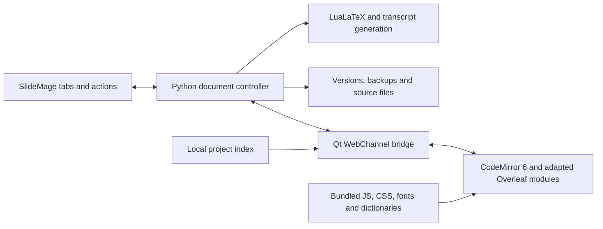

# Embedded CodeMirror 6 editor with Overleaf LaTeX features

Status: implementation plan only. No application changes implemented.
Date: 2026-09-26.

## Objective and scope

Replace SlideMage's custom source editing surface with an offline CodeMirror 6
editor, adapting Overleaf's published LaTeX and BibTeX editing modules. Preserve
SlideMage's project management, versioning, compilation, accessibility tools and
editing actions. Autocomplete is a required release feature.

The scope covers the source editing features discussed: parsing, highlighting,
folding, indentation, pairing, snippets, completion, navigation, diagnostics,
documentation, math previews, spelling, search, multiple selections, keyboard
modes, themes, and existing toolbar/AI workflows. It also includes local image,
symbol and table insertion helpers. It does not require an Overleaf server,
account, database, Docker installation, network connection, or cloud compilation.
Collaboration, online reference managers, comments shared between users and
Overleaf's whole visual document editor are separate products/features, outside
this source-editor migration. Licensing is decision 1 under "Decisions that
shape the work": it must be settled before Phase 0 copies any Overleaf code.
Retain upstream notices and provenance when importing files.

## Confirmed starting point

- `qt_slide_source_tab.py` defines `LatexPlainTextEdit(QPlainTextEdit)` and
  `SlideSourceTab`. The tab also edits deck source and the bibliography.
- Its actions directly use `QTextCursor`, `QTextDocument`, selections, block
  visibility and synchronous text reads. A widget substitution alone is insufficient.
- Saves include version choices, frozen slide versions, backups, line-ending
  preservation and stale-file detection through `slide_source.py`.
- PDF and transcript previews consume unsaved editor text. The new editor must
  continue to support this without writing the source file first.
- Settings, theme changes, AI dialogs, syntax-fix dialogs, tab closing and project
  switching also interact with source editor state.
- PySide6 6.11.2 in the inspected project virtual environment can import
  `QtWebEngineWidgets` and `QtWebChannel`. This confirms module availability only;
  a rendered editor and frozen executable still need verification.
- The v3.32.1 Linux executable is about 118 MiB (123 MB) on disk; its release zip
  is 122 MB. The installed WebEngine core library alone is about 194 MiB
  uncompressed. Measure actual package size, startup time and memory in the
  prototype; those figures cannot simply be added to predict the compressed
  executable size.
- `packaging/slidemage.spec` builds a **one-file** executable, which unpacks all
  bundled libraries to a temporary folder on every launch. Releases ship Linux and
  Windows builds, and CI tests both. Windows is a primary platform (MiKTeX,
  TeXstudio, cloud-synced project folders), not an afterthought.
- Info → "Check for updates…" (`updater.py`) installs a release by unpacking a
  flat zip (`SlideMage-linux.zip`/`SlideMage-windows.zip`) and replacing the single
  running binary. Installed copies may live in a cloud-synced folder (at least
  one does: `~/Nextcloud/SlideMage/`).
- SlideMage is licensed CC BY-SA 4.0, with Stefan Palan / University of Graz
  named as copyright holders in `LICENSE`. The Overleaf repository is AGPL-3.0.
- SlideMage **already ships AGPL code**: `pymupdf` (used in `pptx_export.py`) is
  "GNU AFFERO GPL 3.0 or Artifex Commercial License", and PyInstaller bundles it
  into every release binary. The other runtime dependencies are permissive or
  LGPL (PySide6 LGPL-3.0, pillow MIT-CMU, lxml BSD-3-Clause, python-pptx MIT,
  odfpy Apache/GPL).

## Decisions that shape the work

These are not implementation details; each changes what gets built.

1. **Licensing — decide before Phase 0 copies Overleaf code.** Otherwise the
   prototype, and possibly much of the feature work, rests on code that may not
   be shippable. The decision belongs to the copyright holders (Stefan Palan /
   University of Graz; contributors' own code too; the university may have an IP
   policy for software). It is practical orientation below, not legal advice; the
   university's IP office can confirm it.

   *Proposed model:*
   - SlideMage's code (`src/slidemage/`, `packaging/`, tests) under
     **GPL-3.0-or-later**. GPLv2 does not work: only GPLv3 may be combined with
     AGPLv3 (section 13 of both licences). Creative Commons declares CC BY-SA 4.0
     one-way compatible with GPLv3, so GPLv3 is the natural step from the
     current licence.
   - The LaTeX framework, documentation and example content stay **CC BY-SA 4.0**.
   - PyMuPDF and any Overleaf-derived files stay **AGPL-3.0**, clearly labelled,
     shipped in the same program. The AGPL's network clause applies to the
     combination but has no practical effect on a locally run desktop app.
   - Slides, decks, PDFs and course material made *with* SlideMage are not
     covered; they keep whatever licence their authors choose.

   *Obligations under this model:* anyone who receives a binary may obtain the
   complete source and modify and redistribute it, so the repository has to be
   public or the source attached to each release (a private repository alone is
   not enough). For the editor, "complete source" means the unminified
   TypeScript/JavaScript plus the build scripts, not just the bundle. Include
   notices for every bundled part (PyMuPDF, Qt/PySide6, CodeMirror, Overleaf,
   MathJax, Hunspell and dictionaries). Nobody, the university included, can
   later sell a closed-source version unless all rights holders agree and every
   AGPL part is replaced or licensed commercially.

   *Overleaf specifics:* files copied from Overleaf remain AGPL including our
   changes to them; only new files are ours to license. Keep every
   Overleaf-derived file in one directory (`editor_frontend/overleaf/`) with a
   provenance record (upstream path, pinned commit, local changes). Take files
   only from the public `overleaf/overleaf` repository and check each one,
   including fonts, icons and data (Overleaf also has non-public commercial
   parts). The AGPL grants no trademark rights: the docs may say parts are based
   on Overleaf, but the editor must not be presented as "Overleaf".

   *If the model is accepted:* use Overleaf's grammar and completion logic as
   planned.

   *If it is rejected:* PyMuPDF is a problem **today**, independent of the
   editor: buy Artifex's commercial licence or replace it with a permissively
   licensed PDF library (e.g. pypdfium2, Apache-2.0/BSD). The editor then takes
   the permissive path:
   - no permissive full LaTeX grammar for CodeMirror 6 exists;
     `codemirror-lang-latex` (TeXlyre) is derived from Overleaf's grammar and is
     AGPL-3.0 too;
   - use `@codemirror/legacy-modes`' `stex` mode (MIT) for highlighting, plus a
     small SlideMage-specific context scanner (math, comment, `\cite{…}`,
     `\slide{…}`), or `@unified-latex` (MIT, full parser; not incremental, which is
     fine at SlideMage's file sizes: the largest example slide is 96 lines);
   - `codemirror-lang-bib` (MIT) for BibTeX, MathJax (Apache-2.0) for math
     preview, Hunspell (LGPL option) for spelling;
   - Overleaf's source may serve as a reference for behaviour, never be copied.

   Either way, completion *data* is ours to write: offline, Overleaf bundles only
   about 100 common commands and gets package commands from its server
   (`metadata.ts`). LaTeX Workshop's MIT-labelled data is mostly converted from
   TeXstudio's GPL `.cwl` files, so check its provenance before bundling it.
2. **Packaging: one-folder build, installed locally per user (default).**
   Measured on 2026-09-26: a one-folder PyInstaller build of the current app with
   WebEngine and WebChannel added has 3,301 files and 705 MB unpacked. Of those,
   2,431 files (30 MB) are Qt QML modules and 210 files (53 MB) Qt translations;
   the Qt libraries are 131 files and 360 MB (WebEngine core alone 195 MB).
   - *Not one-file:* it would unpack the same ~700 MB to a temporary folder on
     every launch, which is several seconds of startup and worse on Windows,
     where antivirus scans each unpacked file.
   - *Trim the build:* a widgets application should not need the QML modules;
     exclude them and keep only English and German translations. Expected result
     roughly 700 files. This is an estimate: Phase 0 must confirm that an editor
     view still renders and that `QtWebEngineProcess` starts without them.
   - *Install locally, never into a synced folder:* `%LOCALAPPDATA%\Programs\SlideMage`
     on Windows and `~/.local/share/slidemage` on Linux, neither needing admin
     rights. Only projects are synced. A synced program folder would upload
     hundreds of MB per update, and on Windows the sync client and the updater
     would contend for files the running app locks, risking conflict copies and
     half-updated installs; a program folder is identical on every machine, so
     syncing it gains nothing.
   - This requires the updater, release-asset and install-location changes in
     Phase 5. One-file stays the fallback only if Phase 0 shows the one-folder
     build failing where one-file does not.
3. **Go/no-go thresholds**, proposed here and confirmed before Phase 0 ends,
   measured on the same machine against the current build:
   - cold start at most 2 s slower; warm start at most 1 s slower;
   - typing latency under 16 ms on the largest example deck, and completion popup
     under 100 ms;
   - under 60 MiB extra memory per additional open editor tab;
   - release zip under 300 MB per platform.
4. **Fallback if Phase 0 fails a threshold.** Autocomplete is the required
   feature, and it does not depend on WebEngine: the existing `QPlainTextEdit`
   can host a `QCompleter` fed by the same local project index. Phases 1 and the
   index work in Phase 3 are useful on either path, so a no-go loses only the
   Phase 0 prototype.

## What the switch costs

No current feature may be dropped (Phase 1 and 2 gates), but much of today's
editor is SlideMage's own work that Overleaf does not provide. Weigh the lists
below against the fallback in decision 4 above.

**Unchanged — Qt controls around the editor.** Save with version prompt,
Revert, Close / Close and save; Preview, Render to PDF, Render transcript, image
summary; Duplicate / Rename / Delete slide, set language; Check syntax, AI draft,
Add citation. They stay as they are and only read the text through the new
asynchronous interface.

**Must be rebuilt — SlideMage features in `qt_slide_source_tab.py` with no
Overleaf equivalent.** This is the Phase 2 porting checklist:

| Current behaviour | Migration note |
| --- | --- |
| Enter after `\begin{env}` inserts `\end{env}`; Enter after `\item` continues the list (`LatexPlainTextEdit._smart_return`) | Overleaf closes environments during completion, not on Enter. Port it, or decide deliberately to adopt Overleaf's behaviour. |
| Wrap selection in `\textit`, `\textbf`, `\underline`, `\texttt`, `\source`, `\footnote`, and in environments, including multi-line selections (`_wrap_or_insert`, `_wrap_environment`) | Buttons stay; logic becomes an editor command. |
| Colour dropdown with swatches, insert-command dropdown (`INSERT_COMMANDS`), hyperlink, multilingual insert | Qt dropdowns stay; insertion becomes an editor command. |
| Header-comment fold: folded on open, line numbers skip it (`_set_header_folded`) | CodeMirror folds, but this exact behaviour must be built. |
| Find/replace bar: Ctrl+F, Ctrl+H, Esc, Previous/Next, Replace, Replace All | Design decision: keep the Qt bar and forward calls, or adopt CodeMirror's search panel (different look and keys). |
| A–Z jump bar in `.bib` tabs (`_jump_to_bib_letter`) | Buttons stay; jumps go through `reveal_position`. |
| Reindent (`_on_reindent`) | Own logic, to be ported. |
| Minimal replacement on save: version-marker change keeps cursor, selection, scroll and undo (`_apply_minimal_text_replace`) | Port carefully; covered by the verification matrix. |
| Highlighting in the app's theme colours, including TODO/FIXME in comments, light/dark (`LatexSyntaxHighlighter`) | Rebuild as a CodeMirror theme; Overleaf has no TODO highlighting. |

Ctrl+/ commenting and brace matching already exist in Overleaf/CodeMirror.

**Lasting disadvantages, even after a clean migration:**

- **Size and startup:** about 705 MB unpacked (measured) versus about 118 MiB
  today, and a slower start.
- **Robustness:** new failure modes: GPU/driver problems, sandbox issues on some
  Linux and remote-desktop setups, crashed renderer processes (hence the recovery
  drafts in Phase 1).
- **Native behaviour:** today's editor is a Qt widget, so the context menu, input
  methods, shortcuts and focus match the rest of the app. In WebEngine each must
  be configured and forwarded, and small differences remain.
- **Accessibility:** Qt exposes the text field to screen readers directly;
  CodeMirror in WebEngine does so differently and needs its own testing, which
  matters for a tool with SlideMage's accessibility focus.
- **Simplicity:** one Python file (~2,150 lines) becomes Python, TypeScript and an
  npm build plus tracking Overleaf upstream. Contributors need web skills; CI
  needs Node.
- **Tests:** today's editor tests drive the text directly in headless pytest.
  With WebEngine they cross an asynchronous JavaScript boundary and become slower
  and more fragile.
- **Licence:** Overleaf-derived code brings AGPL obligations (decision 1).

In return: autocomplete, a real LaTeX grammar, spellcheck, math preview and
linting. If autocomplete alone is the goal, the fallback avoids every cost above
and keeps today's features untouched.

## Architecture

Use a `QWebEngineView` for the source area within the existing Qt tab. Load a
bundled HTML/JavaScript application through a Qt resource or restricted local
scheme. Bundle all runtime dependencies; Node/npm are build tools only. Keep
Overleaf's frontend code adaptations in a small, versioned module collection.
Do not import Overleaf's application-wide editor bundle, React contexts,
collaboration transport or service clients.

CodeMirror owns the live editing buffer, selection and undo history. Python owns
the saved baseline, file identity, project index, version decisions and writes.
The bridge carries explicit messages with document ID, document generation,
revision and request ID. Each tab is isolated; responses for a closed tab,
renamed document or previous project are discarded.

Introduce an editor interface with asynchronous operations:

- `load_document(text, identity, options)` and an explicit ready acknowledgement;
- `request_snapshot()` returning text, revision and selection;
- `apply_edits(edits, expected_revision, undo_group)` and an acknowledgement;
- `execute_command(name, arguments)` for selection operations and snippets;
- `reveal_position`, `set_theme`, `set_options`, `set_completions`,
  `set_diagnostics`, and `dispose`;
- events for dirty state, selection, edit revision, save requests and failures.

Keep operations close to the buffer where possible: formatting a selection,
commenting, find/replace and snippet insertion should execute as CodeMirror
transactions. Pass plain text as structured data, never interpolate it into
JavaScript source. Specify positions as line plus UTF-16 column at the bridge;
convert explicitly when Python code uses Unicode code-point offsets. Internally,
use LF and preserve the original file EOL convention when writing.

The bridge is asynchronous. Save, render, AI requests and close must request an
authoritative snapshot; a debounced Python cache is not sufficient. Saving
revision R must not mark later revision R+1 clean. During a save transaction,
freeze edits briefly or queue them explicitly; never block Qt while waiting for
a JavaScript callback. A cancelled or failed save keeps the tab and its text.

## Complete feature inventory

All rows below are planned scope, delivered in the phases that follow.

| Feature | Upstream basis and SlideMage adaptation | Acceptance |
| --- | --- | --- |
| LaTeX/BibTeX parsing and highlighting | Overleaf `lezer-latex`, `lezer-bibtex`, language configuration and token styles | Comments, escaped characters, multiline math, nested groups and BibTeX fields highlight correctly; incomplete input remains editable. |
| Environment and section folding | Adapt language fold rules; preserve the existing header-comment fold | Folding never removes source text, changes line numbers or drops folded content from save/render. |
| Smart indentation and pairing | Adapt indentation, auto-pair and bracket matching extensions | Tab-width settings, begin/end completion and list-item continuation work without duplicate end tags; one undo reverses each automatic insertion. |
| Snippets | Adapt upstream snippet support; add Beamer and SlideMaster structures | Placeholder navigation with Tab/Shift-Tab, selection wrapping and undo work for frames, lists, figures, equations and custom environments. |
| Full autocomplete | Adapt language completion providers and popup behavior, fed by local indexes | See dedicated contract below; completion works without network or Overleaf services. |
| Search and replace | CodeMirror search and custom Qt action forwarding | Literal/regex, case and whole-word options, replace one/all, selection scope and wraparound; replacements form sensible undo groups. |
| Multiple cursors and rectangular selections | CodeMirror selection extensions | Typing, deletion and completion affect intended selections; unequal snippet contexts fail predictably rather than altering unrelated text. |
| Keyboard modes | Standard commands plus optional Vim/Emacs packages | Save/render/close shortcuts remain reachable and do not fire twice; command settings persist. |
| Line numbers and navigation | CodeMirror gutter, go-to-line and outline helpers | Real source line numbers, section/environment navigation and bibliography-key jumps work with folded content. |
| Go to definition | Local label, citation, macro and file indexes | Navigate to a matching local source location; ambiguous definitions offer a choice. |
| Inline diagnostics | Local parser checks plus mapped compiler diagnostics | Clickable source locations, severities and stale-result removal; slide fragments do not get spurious missing-document errors. |
| Command documentation | Adapt tooltip extension and available bundled data; add SlideMaster command help | Hover shows command purpose/arguments; unknown commands remain usable and do not trigger network requests. |
| Math preview | Adapt Overleaf math-preview extension with bundled renderer/assets | Preview standard math from unsaved source; unsupported custom macros show a clear fallback to the real LuaLaTeX slide preview. |
| Spellchecking | Adapt spelling UI with a bundled local engine and EN/DE dictionaries | Check prose while excluding commands, paths, citation keys and math; language selection and personal dictionary persist. |
| Symbol palette | Adapt standalone palette/data where reusable | Search symbols, preview supported symbols, insert LaTeX at the intended selection as one undo step. |
| Formatting toolbar | Route existing bold/italic/color/link/environment actions through editor commands | Existing shortcuts, multiline selection wrapping and undo semantics are preserved. |
| Tables and images | Local source insertion/edit helpers; reuse existing media handling | Generate LaTeX, preserve project-relative paths, and expose the edit before save; cancelling makes no change. |
| Themes and presentation | Adapt selected source-editor themes and completion styling | Existing light/dark mode, font, zoom, wrapping, indentation guides, whitespace display and tab width work at runtime. |
| AI draft and syntax fixes | Existing Python tools through revision-aware snapshot/edit operations | Results never silently overwrite newer text; accepted changes preserve cursor where possible and undo in one step. |
| SlideMage save and preview workflows | Python controller using current project services | Versioning, history, transcript summaries, language/rename, citation creation, PDF and transcript previews continue to work. |

Full visual editing of arbitrary Beamer/TikZ source is not implied by math
previews or insertion helpers. Source text remains authoritative in this plan.

## Autocomplete contract

Use Overleaf's parser context and completion machinery where practical. Replace
its project data providers with a local index published by Python:

1. **Commands:** standard LaTeX, Beamer, installed/bundled command metadata,
   SlideMaster macros and locally declared `newcommand`/`def` variants supported
   by the scanner. Display arguments/help; flag uncertain signatures as such.
2. **Environments:** standard and project-defined environments; insert paired
   begin/end structures and snippet placeholders where appropriate.
3. **Citations:** keys plus author, title and year from `Slidemaster.bib`, including
   `cite`, `parencite`, `textcite`, `fullcite` and comma-separated citation lists.
4. **Labels/references:** project labels for ref-family commands; show file and
   context, and handle duplicate labels explicitly.
5. **Files/media:** relative paths appropriate to the command and current project
   layout; suggest images for `includegraphics` and source files for `input`.
6. **Slides:** IDs/slugs for `slide`, `omitslide`, `conditionalslide` and related
   macros; frozen-version suggestions in the correct `slideversion` arguments.
   Add version/language choices only where their argument syntax supports them.
7. **Math symbols and snippets:** readable names and previews where the bundled
   renderer supports them; insert the corresponding source.
8. **BibTeX editing:** entry types, field names and useful entry snippets in `.bib`
   tabs, using a distinct language configuration.

Context rules must suppress irrelevant suggestions in comments/verbatim text and
avoid offering citation keys in arbitrary arguments. Completion must preserve
existing braces and suffixes, handle escaped characters, Unicode and spaces in
paths, and support keyboard navigation plus an explicit completion shortcut.
Acceptance, cancellation and undo must leave surrounding text intact.

Build the index on project open and update it after saves, bibliography changes,
slide creation/import/rename/deletion, header regeneration and external file
changes. Include unsaved definitions from open buffers without treating them as
saved files. Tag index responses with project generation and revision. Confine
indexing to project/framework roots; avoid scanning build outputs and caches.
Start with incremental parsing of changed files, cache by content identity, and
perform work off the GUI thread. Do not execute TeX to discover completions.

## Implementation phases and gates

### Phase 0 — Pin upstream and prove the runtime

Entry condition: the licensing decision (decision 1) is recorded. If the model
is rejected, Phase 0 pins the permissive packages instead of Overleaf and skips
the Overleaf audit below; everything else applies unchanged.

- Pin an Overleaf commit and compatible CodeMirror/Lezer dependencies in a
  frontend lockfile. Record copied source paths, modifications and test fixtures.
- Audit imports from the selected modules. Replace Overleaf settings facets,
  app globals, module-loader macros, event buses, telemetry and project APIs with
  narrow local interfaces. Confirm which command/help data are actually present.
- Build a standalone offline editor harness with representative slide, deck and
  bibliography files. Exercise incomplete fragments and project macros.
- Produce Linux **and Windows** PyInstaller prototypes with the WebEngine helper,
  resources, dictionaries and JS assets, as trimmed one-folder builds (one-file
  only as a startup comparison).
  Test Linux on Wayland and X11 and Windows 10/11, without disabling Chromium's
  sandbox. Measure cold/warm startup, size and memory with 1 and 10 documents
  against the thresholds above. Record the file count and unpacked size before
  and after trimming. On Windows, also check long install paths, a non-ASCII user
  name and GPU-less rendering (e.g. a VM or remote desktop).
- Choose one WebEngine view per tab initially. If measured cost is excessive,
  test a shared view with per-document CodeMirror state/history before proceeding.

Gate: the packaged harness loads offline on both platforms, preserves text,
demonstrates LaTeX completion and meets the thresholds. Record measurements, the
packaging choice and a dependency inventory with each file's licence. Import
success alone does not pass this gate; a failed threshold triggers the fallback
decision rather than silent continuation.

Phase 1 does not depend on this gate and can start in parallel.

### Phase 1 — Separate document operations from Qt's text widget

- Introduce the document controller and editor interface. Adapt the current Qt
  editor first, preserving existing behavior as the migration reference.
- Convert AI/syntax dialogs, toolbar actions, settings, global theme changes,
  tab close and project switch to the interface. Remove direct editor-widget
  dependencies from callers.
- Preserve path-based tab deduplication, rename rekeying, return-to-tab behavior,
  deck-save callbacks and bibliography sorting on first open and close. Coordinate
  sorting with saved baselines and index updates so it cannot overwrite a live draft.
- Centralize save orchestration: snapshot, version choice, disk conflict check,
  freeze/back up/write and acknowledgement. Validate stale state before creating
  frozen versions; fail without marking clean or closing. Serialize app-owned
  writes, recheck before commit and use atomic replacement where appropriate.
- Define recovery behavior for bridge failure, renderer exit and failed loads.
  Keep the latest acknowledged draft plus ordered edits recoverable locally;
  never reload a failed renderer over the only unsaved copy. Store recovery drafts
  in the per-user state folder (next to `project.config_dir()`), keyed by project
  path and file, never inside the project: project folders are often cloud-synced,
  and a draft written there would sync, conflict and look like project content.

Gate: existing source editor actions and save/close cancellation work through the
new interface with the old editor. No editing behavior is removed to ease migration.

### Phase 2 — Embed CodeMirror and migrate existing actions

- Add the local asset loader, bridge, readiness/error states and CodeMirror editor
  adapter. Keep both backends selectable during migration, one writer per document.
- Implement snapshot barriers, revisions, structured edits, dirty tracking,
  selection/Unicode conversion, undo grouping and tab disposal.
- Port existing insert, comment, reindent, find/replace, header folding, citation,
  rename/language and AI actions, using the "Must be rebuilt" table in "What the
  switch costs" as the checklist. Connect PDF/transcript preview to live snapshots.
- Apply themes/settings; configure focus, clipboard, IME, shortcuts and tooltips.

Gate: edit → preview without save → save/version → undo → close/reopen works for
slide, deck and `.bib` tabs. Concurrent typing, delayed callbacks and open dialogs
cannot route data to the wrong document or overwrite newer edits.

### Phase 3 — Integrate all language support and autocomplete

- Port the pinned LaTeX/BibTeX grammars and required tree utilities; add highlighting,
  indentation, pairing, folding, outline and snippets.
- Implement the local project index and every provider in the autocomplete contract.
- Add command documentation, go-to-definition, settings and complete popup behavior.
- Cover SlideMaster custom environments, version calls, language variants, Beamer
  overlays and bibliography updates in fixtures.

Gate: all eight autocomplete categories work offline, update after local changes,
and pass context, Unicode, undo and stale-project tests. This phase is mandatory
before making CodeMirror the default.

### Phase 4 — Diagnostics and editing aids

- Add fragment-aware parser diagnostics and map real compiler errors back to source
  files/lines, accounting for generated preview wrappers. Tag diagnostics with the
  compiled revision; clear or identify results that no longer match the buffer.
- Add math preview and local spellcheck, command tooltips and symbol palette.
- Complete table/image helpers, multiple cursors, rectangular selections, Vim/Emacs,
  regex/search options, whitespace and indentation guides.
- Keep checks honest: missing macros in an unopened preamble are not automatically
  errors; a syntax tree or MathJax preview cannot establish LuaLaTeX correctness.

Gate: each feature in the inventory has an automated or recorded manual acceptance
check. Test English/German prose, arbitrary partial edits and custom macros.

### Phase 5 — Packaging, regression verification and rollout

- Bundle compiled frontend artifacts in wheels, sdists and PyInstaller builds;
  build JS in CI with pinned dependencies (`npm ci` against the lockfile, in both
  `ci.yml` and `release.yml`, before PyInstaller). Users install/run without Node
  or npm. Keep `release.yml`'s tag-equals-`VERSION_NUMBER` check.
- Change updates in two releases for the one-folder build. Release N ships an
  updater that can replace a whole install folder: unpack the new version next to
  the current one, switch on restart, and keep the previous folder until the new
  one has started. Release N+1 switches the build, under **new asset names**
  (e.g. `SlideMage-linux-dir.zip`). Older updaters look only for the old flat-zip
  names and flatten paths while unpacking; with new names they report "no
  download for this platform" instead of installing a broken tree.
- The switch also moves the install location. When the updater runs from a
  folder that looks cloud-synced or is not the per-user default, it installs into
  the default location instead and says so, and the Linux desktop entry and
  Windows Start-menu shortcut are updated to point there. Document the one-time
  manual reinstall for anyone who skips release N, including removing the old
  copy from a synced folder.
- Verify that supported PySide6 distributions provide WebEngine and WebChannel;
  specify compatible dependency bounds and account for platform wheel availability.
  Check PyInstaller hook output for the helper process, resources and locales in
  an actual frozen build instead of assuming imports collect everything.
- Add offline WebEngine integration checks and packaged Linux smoke checks, plus
  Windows/macOS checks wherever the existing release workflow supports them.
- Keep the renderer restricted to packaged assets. Project source is text, and
  paths/documentation passed to JS are escaped as data. Expose only document-specific
  bridge methods; local assets and language features require no remote requests.
- Verify assistive navigation, IME, German keyboard shortcuts, clipboard, scaling,
  focus between native controls and the editor, and multi-tab performance manually.
- Enable CodeMirror by default once the **default-switch criteria** below are
  met. Keep the old backend as a selectable recovery option (a per-user setting,
  so one machine's WebEngine trouble doesn't switch everyone sharing the project)
  for at least one release after the switch; never open both as writable views of
  the same file. Document fallback and draft recovery.
- Update README and SlideMage documentation with feature/settings descriptions,
  developer frontend build commands, troubleshooting and upstream update procedure.

## Proposed file ownership and interfaces

Names of new modules below are proposals; confirm conventions during Phase 0.

| Area | Files | Responsibility |
| --- | --- | --- |
| Document lifecycle | new `editor_document.py`, `editor_api.py`; `slide_source.py` | Snapshots, revisions, safe writes, version transactions and recovery. |
| Qt integration | new `qt_code_editor.py`, `qt_editor_bridge.py`; `qt_slide_source_tab.py`, `qt_gui.py` | View lifetime, action forwarding and asynchronous save/close. |
| Existing integrations | `qt_ai_draft_dialog.py`, `qt_syntax_check_dialog.py`, `qt_settings_dialog.py`, `qt_theme.py` | Remove widget coupling, configure editor and guard stale edits. |
| Local knowledge | new `editor_project_index.py`; `bibliography.py`, `slide_ids.py`, `deck_editor.py`, `slide_language.py` | Publish completion/navigation data and invalidate it on changes. |
| Frontend | new `editor_frontend/` and bundled `src/slidemage/assets/editor/` | TypeScript app, adapted upstream modules, styles, dictionaries and reproducible build. |
| Build/release | `pyproject.toml`, `packaging/slidemage.spec`, `.github/workflows/ci.yml`, `release.yml` | Ship assets, WebEngine dependencies, frontend tests and frozen smoke checks. |
| Verification | existing editor GUI/regression tests plus new frontend/controller/bridge tests | Preserve existing workflows and exercise real browser/Python boundaries. |

For implementation, use at most two workers concurrently: one owns the frontend
and upstream adaptations, the other owns the Python controller and index. Agree on
the bridge schema first. The lead owns integration in `qt_slide_source_tab.py` and
`qt_gui.py`, then an independent reviewer checks data loss, callback races, packaging
and regressions. Workers do not edit the same files or delegate further.

## Verification matrix

- **Controller tests:** stale disk writes; version/freeze/backup ordering; EOL and
  Unicode round trips; failed saves; rename and project switch; recovery draft
  retention/cleanup; concurrent revisions and save cancellation.
- **Frontend tests:** real grammars, completion contexts, snippets and undo,
  folding, partial source, selection edits, diagnostics and keyboard command routing.
- **Bridge integration:** real QWebEngine/WebChannel delivery, load failure, delayed
  replies, renderer failure, latest-keystroke save/render, rapid tab switching and
  destruction during pending requests.
- **Existing workflows:** run repository-required pytest and lint checks, existing
  source editor GUI regressions, and demo deck compilation from the CI workflow.
  Extend assertions to new backend behavior rather than simply deleting tests that
  reference `QTextCursor`.
  Retain coverage from `test_find_replace_gui.py`, `test_hyperlink_command.py`,
  `test_review_gui.py` and `test_regressions.py`, particularly stale AI proposals,
  cancelled close/save, stale disk writes and UTF-16 cursor preservation after
  version-marker replacement. Verify cursor, selection, scroll and undo survive
  that replacement without resetting the whole document.
- **Packaged acceptance:** fresh Linux environment with no Node/npm and network
  unavailable; launch, open project, autocomplete, edit, render, save/version and
  reopen. Check copied/installed projects and non-ASCII paths. Exercise a typical
  slide, a large deck and large bibliography; record startup, typing responsiveness
  and memory before/after.

- **Update path:** a packaged build of the previous release updates itself to the
  new one through Info → "Check for updates…" on Linux and Windows, and the
  updated build starts with its editor working.

Two separate finish lines, so the default switch doesn't wait for every aid:

- **Default switch** (CodeMirror becomes the default): Phases 1–3 gates pass;
  every existing editor action, save/version/close path and preview works; all
  eight autocomplete categories work offline; packaged Linux and Windows builds
  pass the packaged acceptance check and the update path.
- **Migration complete:** additionally, every inventory row is delivered and
  verified (Phase 4), and the old backend can be removed.

An editor demo, highlighting-only replacement or autocomplete with hardcoded test
data meets neither.

## Upstream references

- [Overleaf source editor](https://github.com/overleaf/overleaf/tree/main/services/web/frontend/js/features/source-editor)
- [Overleaf LaTeX language modules](https://github.com/overleaf/overleaf/tree/main/services/web/frontend/js/features/source-editor/languages/latex)
- [Overleaf editor extensions](https://github.com/overleaf/overleaf/tree/main/services/web/frontend/js/features/source-editor/extensions)
- [CodeMirror extension APIs](https://codemirror.net/docs/extensions/)
- [Qt WebChannel](https://doc.qt.io/qtforpython-6/PySide6/QtWebChannel/index.html)
- [Qt WebEngine deployment](https://doc.qt.io/qt-6/qtwebengine-deploying.html)

Upstream module names were inspected during the planning conversation. Actual
reusability and dependency closure must be established against the pinned commit
in Phase 0; this plan does not claim those modules are already extracted or tested.
